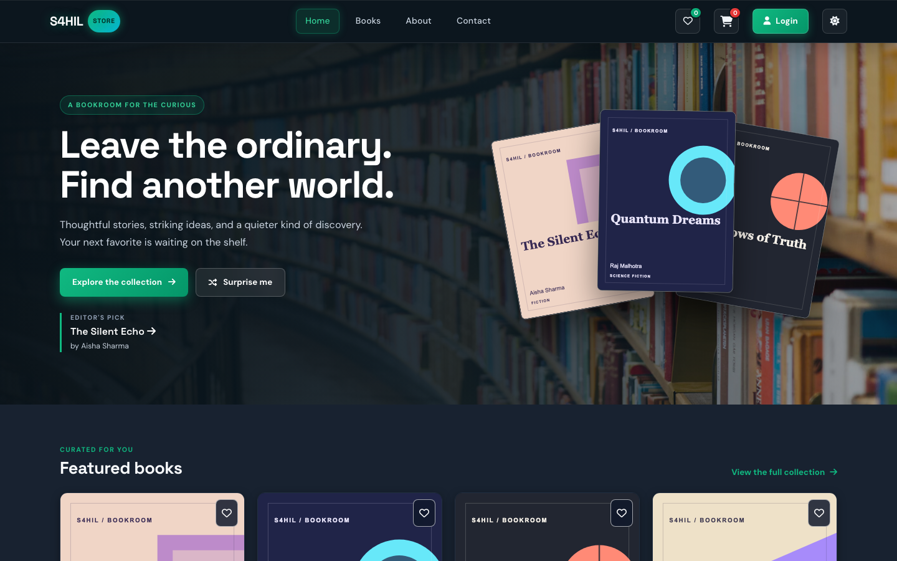
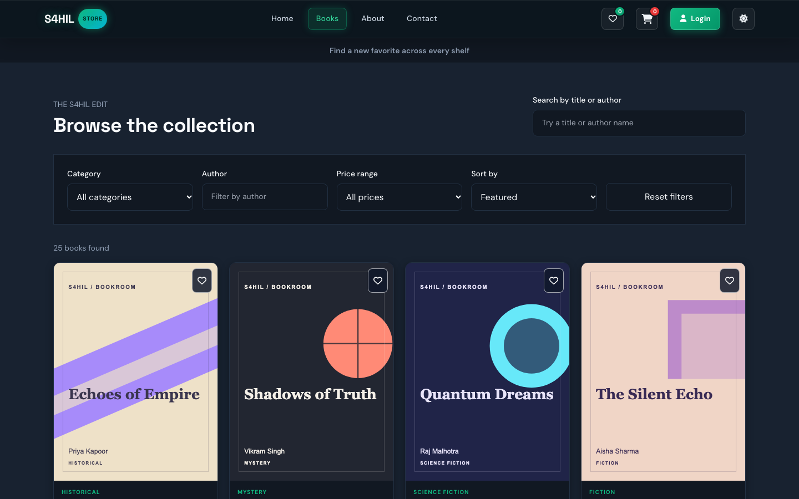
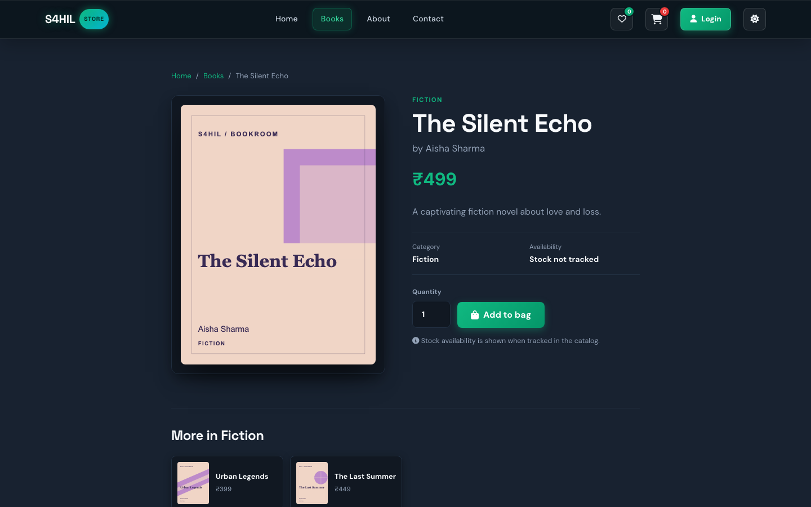
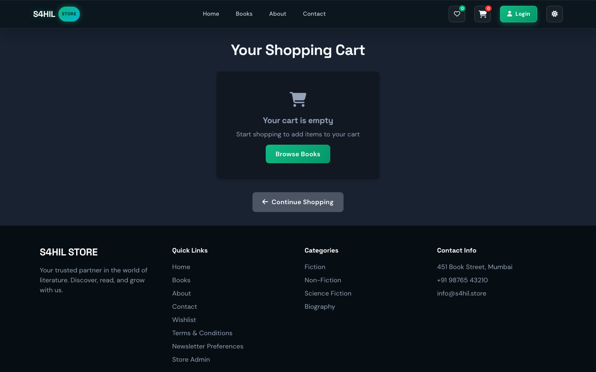
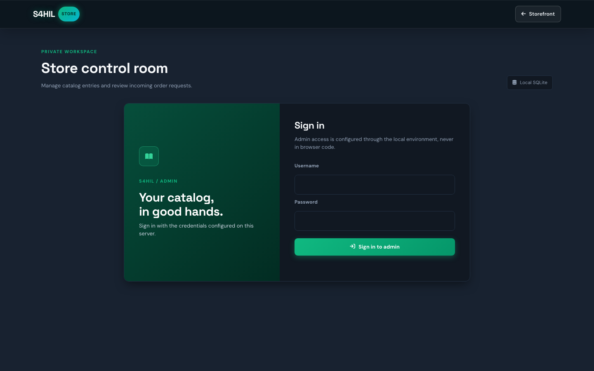
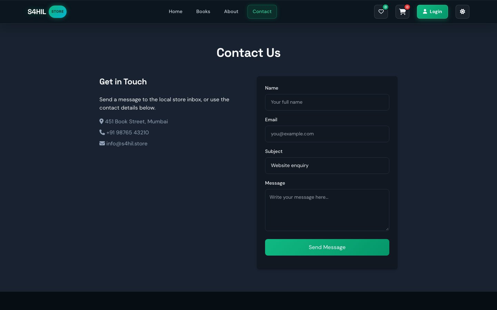

<div align="center">

# S4HIL STORE

**A full-stack bookstore — built with zero runtime dependencies beyond Node.js.**

[](https://nodejs.org/)
[](https://expressjs.com/)
[](https://nodejs.org/api/sqlite.html)
[](LICENSE)

</div>

---

## Overview

S4HIL STORE is a complete, self-contained online bookstore platform. It ships with a curated catalog of 25 books across 8 genres, a full shopping cart, guest wishlist, customer accounts, a protected admin dashboard, and a clean REST API — deployable as a clean, production-ready Node.js/Express service.

---

## Screenshots

| Home | Catalog |
|------|---------|
|  |  |

| Book Detail | Shopping Cart |
|------------|--------------|
|  |  |

| Admin Dashboard | Contact Page |
|----------------|-------------|
|  |  |

---

## Features

### 🛍️ Storefront
- **Hero landing page** with featured book showcase and editor's pick
- **Live catalog** (`/books`) — search by title/author, filter by category & price range, sort by featured/newest/price, and paginate
- **Book detail pages** with full metadata, auto-generated SVG cover art, related books, and add-to-cart
- **Dynamic cover art** — genre-specific color palettes rendered as inline SVG when no cover image is provided

### 🛒 Shopping & Checkout
- **Persistent cart** stored in `localStorage` with quantity controls and live subtotal
- **Free shipping** on orders over ₹999
- **Checkout form** with customer info prefill for logged-in users
- **Stock awareness** — cart enforces stock limits and shows out-of-stock status

### ❤️ Wishlist
- Guest wishlist backed by the SQLite database using a UUID stored in `localStorage`
- Wishlist counters in the header and mobile drawer update in real time

### 👤 Customer Accounts
- Full signup and login — credentials hashed with `scrypt` via Node.js `node:crypto`
- Session cookies (7-day lifetime, `HttpOnly`, `SameSite=Lax`)
- Account page showing full order history with line items
- Zero third-party dependencies — no Passport, no Firebase, no OAuth

### 🔒 Admin Dashboard
- Protected by a separate admin session (8-hour lifetime, `SameSite=Strict`)
- **Catalog CRUD** — create, edit, search, and delete books with cover image URLs or canvas covers
- **Order management** — view all orders, change statuses (`pending_confirmation` → `confirmed` → `cancelled`) with automatic stock restoration on cancellation
- **Contact inbox** — read and archive customer messages
- Rate limiting: 6 failed login attempts locks the admin IP for 15 minutes

### 🏗️ Architecture
- **Server**: Express 5 + SQLite via Node.js 22 built-in `node:sqlite` (`DatabaseSync` — zero external native binaries)
- **Frontend**: Vanilla HTML, CSS (glassmorphism dark/light theme), and plain JavaScript — no framework, no bundler
- **Routing**: Clean RESTful URL aliases (`/books`, `/cart`, `/admin`, etc.) handled by Express static routing
- **Security**: `helmet`, same-origin checks, scoped session cookies, parameterized SQL queries, input validation
- **Persistence**: File-backed SQLite database with automatic fallback to seeded schema

---

## Tech Stack

| Layer | Technology |
|-------|-----------|
| Runtime | Node.js 22.5+ |
| Web Framework | Express 5 |
| Database | SQLite via built-in `node:sqlite` (zero external native dependencies) |
| Auth | Custom `scrypt` password hashing + HMAC session tokens |
| Security | Helmet, same-origin enforcement, rate limiting |
| Frontend | Vanilla HTML5 / CSS3 / JavaScript (ES2020+) |
| Styling | Custom CSS with CSS variables — dark & light themes |
| Icons | Font Awesome 6 (CDN) |
| Tests | Node.js built-in `node:test` runner |

---

## Requirements

- **Node.js 22.5 or later** — required for the built-in `node:sqlite` module
- **npm** — for installing Express and Helmet

> Check your version: `node --version`

---

## Quick Start

### 1. Clone & Install

```sh
git clone https://github.com/YOUR_USERNAME/s4hil-store.git
cd s4hil-store
npm install
```

### 2. Configure Environment

```sh
cp .env.example .env
```

Open `.env` and fill in:

```env
NODE_ENV=development
PORT=3000
DATABASE_PATH=server/data/store.sqlite
SESSION_SECRET=replace-with-at-least-32-random-bytes
ADMIN_USERNAME=admin
ADMIN_PASSWORD_HASH=
```

#### Generate the admin password hash

Run this in your terminal (input is hidden):

```sh
npm run admin:hash
```

Copy the printed `ADMIN_PASSWORD_HASH=...` line into `.env`.

### 3. Initialize the Database

```sh
npm run db:init
```

This creates `server/data/store.sqlite` and seeds **25 books across 8 categories**.

### 4. Start the Application

```sh
# Production start
npm start

# Development (auto-restarts on file changes)
npm run dev
```

Open **[http://localhost:3000](http://localhost:3000)** in your browser.

---

## Page Routes

| Route | Description |
|-------|-------------|
| `/` or `/home` | Landing page — hero, featured books, category cards |
| `/books` | Full catalog with search, filters, sorting, and pagination |
| `/book?id=<id>` | Individual book detail with related books |
| `/cart` | Shopping cart with quantity controls and totals |
| `/checkout` | Order checkout form |
| `/account` | Customer account — order history and profile |
| `/wishlist` | Saved books (guest-linked via localStorage UUID) |
| `/login` | Customer sign-in |
| `/signup` | New customer registration |
| `/about` | Store story and values |
| `/contact` | Contact form (messages stored in SQLite) |
| `/admin` | Admin dashboard (requires login) |
| `/terms` | Terms and conditions |
| `/unsubscribe` | Newsletter unsubscribe page |

---

## REST API Reference

All responses are JSON. Prices are integers (paise / smallest currency unit).

### Public Endpoints

| Method | Path | Description |
|--------|------|-------------|
| `GET` | `/api/health` | Health check |
| `GET` | `/api/books` | List books (supports `search`, `category`, `author`, `minPrice`, `maxPrice`, `sort`, `page`, `limit`) |
| `GET` | `/api/books/featured` | Featured books (supports `limit`) |
| `GET` | `/api/books/:id` | Book detail + related books |
| `GET` | `/api/categories` | All categories with book counts |
| `GET` | `/api/wishlist?guestId=` | Guest wishlist |
| `POST` | `/api/wishlist` | Add to wishlist (`{ guestId, bookId }`) |
| `DELETE` | `/api/wishlist/:bookId?guestId=` | Remove from wishlist |
| `POST` | `/api/orders` | Place an order |
| `POST` | `/api/newsletter` | Subscribe (`{ email }`) |
| `DELETE` | `/api/newsletter` | Unsubscribe (`{ email }`) |
| `POST` | `/api/contact` | Submit contact message |
| `POST` | `/api/auth/signup` | Register a new customer |
| `POST` | `/api/auth/login` | Customer login |
| `POST` | `/api/auth/logout` | Customer logout |
| `GET` | `/api/auth/session` | Check customer session |
| `GET` | `/api/account/orders` | Customer's own order history *(auth required)* |

### Admin Endpoints (`/api/admin/*`)

All admin endpoints require the `s4hil_admin` session cookie.

| Method | Path | Description |
|--------|------|-------------|
| `POST` | `/api/admin/login` | Admin sign in |
| `POST` | `/api/admin/logout` | Admin sign out |
| `GET` | `/api/admin/session` | Check admin session |
| `GET` | `/api/admin/books` | List all books (supports `search`) |
| `POST` | `/api/admin/books` | Create a book |
| `PUT` | `/api/admin/books/:id` | Update a book |
| `DELETE` | `/api/admin/books/:id` | Delete a book |
| `GET` | `/api/admin/orders` | All orders (latest 200) |
| `PATCH` | `/api/admin/orders/:id/status` | Update order status |
| `GET` | `/api/admin/messages` | All contact messages |
| `PATCH` | `/api/admin/messages/:id/status` | Update message status |

---

## Project Structure

```
s4hil-store/
├── index.html                  # Home page
├── package.json
├── .env.example                # Environment variable template
│
├── pages/                      # All HTML pages
│   ├── books.html              # Catalog
│   ├── book.html               # Book detail
│   ├── cart.html               # Shopping cart
│   ├── checkout.html           # Checkout
│   ├── account.html            # Customer account
│   ├── wishlist.html           # Wishlist
│   ├── login.html              # Customer login
│   ├── signup.html             # Customer signup
│   ├── admin.html              # Admin dashboard
│   ├── about.html              # About page
│   ├── contact.html            # Contact form
│   ├── terms.html              # Terms of service
│   └── unsubscribe.html        # Newsletter unsubscribe
│
├── assets/
│   ├── css/
│   │   └── styles.css          # All styles (dark/light theme, components)
│   ├── js/
│   │   ├── store.js            # Cart, wishlist, nav, theme toggle
│   │   ├── api.js              # BookstoreApi — fetch wrapper + guest ID
│   │   ├── catalog-page.js     # Books page — filters, pagination, URL sync
│   │   └── catalog-ui.js       # Book card rendering + wishlist toggles
│   └── images/
│       └── favicon.svg         # Brand favicon
│
├── server/
│   ├── app.js                  # Express app factory + startup
│   ├── auth.js                 # Admin auth (login, session, rate limiting)
│   ├── customer-auth.js        # Customer auth (signup, login, session)
│   ├── routes/
│   │   ├── public.js           # Public REST API routes
│   │   └── admin.js            # Admin REST API routes
│   ├── db/
│   │   ├── database.js         # SQLite setup, migrations, seeding
│   │   ├── schema.sql          # Full database schema
│   │   └── init.js             # npm run db:init entry point
│   ├── scripts/
│   │   └── hash-password.js    # npm run admin:hash entry point
│   └── data/
│       └── books.json          # Seed data (25 books)
│
├── test/
│   └── store.test.js           # Full integration test suite
│
└── docs/
    └── screenshots/            # Live page screenshots
```

---

## Database Schema

The SQLite database contains 8 tables:

| Table | Purpose |
|-------|---------|
| `books` | Book catalog with pricing, stock, and metadata |
| `categories` | Book genres/categories |
| `users` | Registered customer accounts |
| `orders` | Customer orders with shipping details |
| `order_items` | Individual line items per order |
| `wishlist` | Guest wishlist entries (UUID-keyed) |
| `newsletter_subscribers` | Email subscriptions |
| `contact_messages` | Customer contact form submissions |
| `schema_migrations` | Migration version tracking |

---

## Running Tests

```sh
npm test
```

The test suite runs **entirely in-memory** (no disk writes) using Node.js's built-in `node:test` runner. It covers:

- Catalog search, filtering, pagination, and price range queries
- Book detail lookups and 404/400 error handling
- Guest wishlist CRUD and customer order history
- Customer signup, session management, and duplicate email rejection (409)
- Contact form and newsletter subscription/unsubscription
- Admin authentication, authorization guards, and catalog CRUD
- Order placement with stock constraints, cancellation with stock restoration
- Clean URL routing and malformed cookie resilience

---

## npm Scripts

| Command | Description |
|---------|-------------|
| `npm start` | Start the production server |
| `npm run dev` | Start with `node --watch` (auto-restart on changes) |
| `npm run db:init` | Initialize database and seed 25 books |
| `npm run admin:hash` | Generate a bcrypt-style hash for your admin password |
| `npm test` | Run the full integration test suite |

---

## Admin Setup (Detailed)

1. Run `npm run admin:hash` in an interactive terminal
2. Enter a password of at least 12 characters (input is hidden)
3. Copy the output line (`ADMIN_PASSWORD_HASH=salt:hash`) into `.env`
4. Set `ADMIN_USERNAME` in `.env` to whatever username you want
5. Set `SESSION_SECRET` to a long random string (at least 32 characters):
   ```sh
   node -e "console.log(require('crypto').randomBytes(32).toString('hex'))"
   ```
6. Restart the server and sign in at [http://localhost:3000/admin](http://localhost:3000/admin)

---

## Security Notes

- Admin credentials are **never** stored in the database or browser — they live only in `.env`
- All passwords use `scrypt` with a random 16-byte salt
- Session tokens are HMAC-signed with `SESSION_SECRET`
- Admin sessions are `SameSite=Strict`; customer sessions are `SameSite=Lax`
- IP-based rate limiting locks out after 6 failed admin logins (15 min) or 8 failed customer logins
- All SQL queries use parameterized statements
- The `.env` file is excluded from git via `.gitignore`

---

## License

MIT — see [LICENSE](LICENSE) for details.

---

<div align="center">
Made with ❤️ by Sahil
</div>
